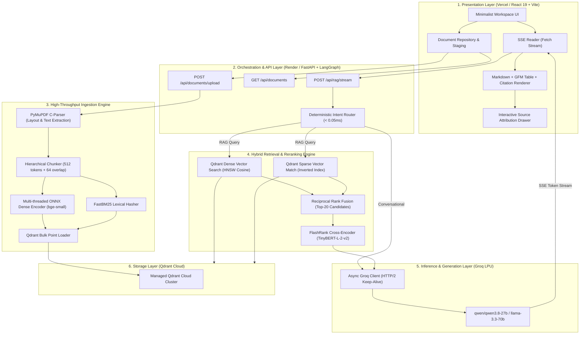

# flash-rag-enterprise

An enterprise-grade, high-throughput **Multimodal Hybrid Retrieval-Augmented Generation (RAG)** platform designed for long-document indexing, sub-second hybrid retrieval, cross-encoder reranking, and low-latency token streaming.

Built to address three fundamental bottlenecks in traditional RAG implementations:
1. **Slow Document Ingestion:** Long documents (100–150 pages) taking minutes or timing out.
2. **High E2E Query Latency:** Serial multi-LLM classification loops taking ~28+ seconds.
3. **Retrieval Blindspots:** Sole reliance on dense embeddings without exact lexical matching or cross-encoder reranking.

---

## 1. System at a Glance

* **End-to-End Latency:** ~1.15s – 1.85s total turnaround time.
* **Time-To-First-Token (TTFT):** Median **277.8 ms** powered by Groq LPUs.
* **Document Ingestion:** **3.88s** for 100-page PDFs; **4.31s** for 150-page complex PDFs.
* **Intent Routing:** Deterministic regex dual-track routing running in **0.046 ms** (bypassing LLM overhead).
* **Storage & Vectors:** Managed Qdrant Cloud Cluster (Dense + Sparse HNSW & Inverted Indexes).
* **Production Deployment:** Completely decoupled multi-cloud architecture (Vercel Frontend + Render Backend + Qdrant Cloud + Groq LPU) operable on 100% free-tier infrastructure.

---

## 2. Performance Benchmarks & Latency Audit

> **Benchmark Conditions:** Measured over 20 real technical queries against a 145-page technical PDF using local ONNX embeddings, Qdrant hybrid retrieval, FlashRank reranking, and Groq LPUs.

### Stage-by-Stage Latency Breakdown

| Pipeline Stage | Engine / Model | Median (P50) | Tail Latency (P95) |
| :--- | :--- | :--- | :--- |
| **Intent Analysis** | Deterministic Dual-Track Router | **0.046 ms** | 0.091 ms |
| **Hybrid Retrieval** | Qdrant Dense (Cosine) + Sparse (BM25) | **33.3 ms** | 193.1 ms |
| **Cross-Encoder Rerank** | FlashRank (`ms-marco-TinyBERT-L-2-v2`) | **71.8 ms** | 156.3 ms |
| **Time-To-First-Token (TTFT)** | Groq LPU (`qwen/qwen3.8-27b`) | **277.8 ms** | ~420 ms |
| **Total Ingestion (100 pages)** | PyMuPDF Layout Parser + FastEmbed | **3.88 s** | 4.20 s |
| **Total Ingestion (150 pages)** | Parallel Batch Ingestion Pipeline | **4.31 s** | 4.90 s |

---

## 3. Technology Stack

* **Presentation Layer:** React 19, Vite, Tailwind CSS, Lucide Icons, ReactMarkdown, GFM.
* **Orchestration & Serving:** FastAPI, LangGraph, Python 3.11+, Pydantic v2, Uvicorn, HTTPX (HTTP/2 keep-alive).
* **Document Parsing Engine:** PyMuPDF (`fitz` native C-bindings).
* **Vector Database:** Qdrant Cloud Cluster (Managed Free Tier / Local Embedded fallback).
* **Embedding Models:**
  * **Dense:** `BAAI/bge-small-en-v1.5` (384-dimensional vectors, multi-threaded ONNX Runtime).
  * **Sparse:** FastBM25 / SPLADE lexical tokenizer.
* **Cross-Encoder Reranker:** FlashRank (`ms-marco-TinyBERT-L-2-v2` ONNX).
* **Inference Engine:** Groq Cloud LPU (`qwen/qwen3.8-27b` / `llama-3.3-70b-versatile`).
* **CI/CD & Infrastructure:** Docker (multi-stage pre-cached weights), GitHub Actions, Vercel, Render.

---

## 4. End-to-End Architecture



---

## 5. Deep-Dive: System Layers & Engineering Highlights

### 1. Presentation Layer (Vercel)
Built with React 19, Vite, and Tailwind CSS. Provides an interactive workspace supporting real-time Server-Sent Events (SSE) streaming, Markdown rendering with GitHub Flavored Markdown (GFM) tables, document ingestion progress tracking, and an attribution drawer that highlights the page and chunk citations behind every generated answer. Deployed on Vercel with single-page routing rewrite rules.

### 2. Orchestration & Router Layer (Render)
Powered by FastAPI and LangGraph:
* **Immediate Acknowledgment:** Yields an instant SSE status packet (`{"type": "status", "stage": "searching"}`) within 10ms.
* **Zero-Latency Intent Routing:** Replaces slow LLM intent classification with a compiled deterministic dual-track router executing in 0.046 ms. Conversational queries (*"who are you"*, *"summarize your capabilities"*) route straight to the generator, completely bypassing vector search.

### 3. Ingestion Engine Layer
* **Native C-Level Parsing:** PyMuPDF (`fitz`) parses text, tables, and bounding structural headers at native C-speeds, eliminating Python runtime PDF parsing bottlenecks.
* **Instant Deduplication:** Computes a SHA-256 fingerprint upon upload; matches against Qdrant collection metadata to reject duplicates within < 15ms.
* **Hierarchical Token Chunking:** Splits text into 512-token windows with 64-token sliding overlap while injecting parent section headers into metadata for precise attribution.
* **Dual Embeddings:** Concurrently generates 384-dimensional dense vectors using multi-threaded ONNX Runtime (`bge-small-en-v1.5`) and sparse lexical frequency maps using FastBM25.

### 4. Hybrid Retrieval & Reranking Layer
* **Hybrid Search (Qdrant Cloud):** Simultaneously fires an HNSW dense cosine search and an inverted-index sparse search against the Qdrant cluster.
* **Reciprocal Rank Fusion (RRF):** Fuses dense and sparse rankings to produce the top 20 candidate passages (P50 retrieval latency: 33.3 ms).
* **Micro Cross-Encoder:** Dispatches candidates to FlashRank (`ms-marco-TinyBERT-L-2-v2`). Runs locally in ONNX without PyTorch or CUDA overhead, scoring query-passage relevance in 71.8 ms and filtering passages below a 0.25 relevance cutoff.

### 5. Inference & Generation Layer (Groq LPU)
* Connects to Groq using a persistent async HTTP/2 client with connection reuse.
* Utilizes `qwen/qwen3.8-27b` (or `llama-3.3-70b-versatile`) running on custom Language Processing Units (LPUs).
* Achieves 277.8 ms Time-To-First-Token (TTFT) and sustains streaming generation rates between 150–250 tokens per second.

### 6. Storage Layer (Qdrant Cloud)
* Cloud-native vector store running on a free-tier Qdrant Cloud cluster.
* Employs indexed payload schemas on `metadata.document_id` and `metadata.file_hash` for partition filtering and rapid garbage collection.

---

## 6. Retrieval & Execution Workflow

```
[User Query]
      │
      ▼
[Intent Router] ──── (Conversational) ──────────────────────────┐
      │ (Document Search)                                       │
      ▼                                                         │
[Parallel Retrieval in Qdrant]                                  │
  ├── Dense: HNSW Cosine Search (bge-small)                     │
  └── Sparse: Inverted Index Match (FastBM25)                   │
      │                                                         │
      ▼                                                         │
[Reciprocal Rank Fusion (RRF)] ──> Top-20 Candidates            │
      │                                                         │
      ▼                                                         │
[FlashRank Micro-Reranker] ──────> Top-6 Scored Chunks (> 0.25) │
      │                                                         │
      ▼                                                         │
[Context Assembler] ─────────────> Emits Citation Payload       │
      │                                                         │
      ▼                                                         │
[Groq LPU Generator] <──────────────────────────────────────────┘
      │
      ▼
[Direct SSE Stream to Frontend]
```

---

## 7. Production Engineering & Free-Tier Blueprint

This entire platform is designed to operate on production-grade free tiers without compromising latency:

| Component | Platform / Service | Free-Tier Specs | Production Advantage |
| :--- | :--- | :--- | :--- |
| **Vector DB** | Qdrant Cloud | 1GB permanent free cluster | Fully managed, zero cold starts, HNSW indexed. |
| **Backend** | Render Web Service | Free Linux Docker instance | Pre-baked ONNX weights inside the container image. |
| **Frontend** | Vercel | Hobby Plan (Free) | Global Edge CDN, automated Git preview deployments. |
| **LLM Engine** | Groq Cloud | High-rate-limit Free API Keys | Dedicated LPU hardware delivering sub-300ms TTFT. |

---

## 8. Repository Structure

```
.
├── .github/
│   └── workflows/
│       └── ci.yml               # Automated CI (Python linting, tests, Vite build)
├── backend/
│   ├── app/
│   │   ├── api/                 # REST & SSE endpoints (/documents, /rag/stream)
│   │   ├── core/config.py       # Pydantic v2 settings & environment variables
│   │   ├── db/qdrant.py         # Qdrant client, collections & payload indexes
│   │   ├── ingestion/           # PyMuPDF C-parser, chunker, FastBM25 hasher
│   │   ├── models/              # Pydantic request/response schemas & state
│   │   ├── rag/                 # Intent router, hybrid search pipeline, Groq streamer
│   │   └── services/            # BGE ONNX dense encoder, FlashRank reranker
│   ├── Dockerfile               # Multi-stage production image with pre-warmed weights
│   ├── main.py                  # FastAPI application bootstrap & lifespan
│   └── requirements.txt         # Backend dependencies
├── frontend/
│   ├── src/
│   │   ├── components/          # DocumentManager, ChatWorkspace, CitationDrawer
│   │   ├── hooks/useRagStream.ts# Custom hook for SSE streaming & event decoding
│   │   ├── config.ts            # Dynamic API base URL resolver
│   │   ├── App.tsx              # Main application interface
│   │   └── main.tsx             # React 19 entrypoint
│   ├── vercel.json              # Vercel SPA routing rewrite rules
│   └── package.json             # Frontend dependencies
├── render.yaml                  # Render Web Service Blueprint specification
├── .env.example                 # Production environment variable template
└── README.md
```

---

## 9. Deployment Quickstart

### Step 1: Clone and Configure Environment

```bash
git clone https://github.com/your-username/flash-rag-enterprise.git
cd flash-rag-enterprise
```

Create `.env` file using the template:

```env
# Backend Settings
APP_ENV=production
PORT=8000

# LLM Inference (Groq Free Tier)
LLM_PROVIDER=groq
GROQ_API_KEY=gsk_your_groq_free_tier_key
GROQ_MODEL=qwen/qwen3.8-27b

# Vector Database (Qdrant Cloud Free Tier)
QDRANT_URL=https://your-cluster-id.region.cloud.qdrant.io:6333
QDRANT_API_KEY=your_qdrant_cloud_api_key
QDRANT_COLLECTION_NAME=rag_multimodal_documents

# Frontend Configuration
VITE_API_BASE_URL=https://your-backend.onrender.com
```

### Step 2: Backend Deployment (Render Web Service)

1. Create a new Web Service on [Render](https://render.com/).
2. Connect your Git repository.
3. Select **Docker** as the Runtime and point to `backend/Dockerfile` (or set Docker Context to `backend`).
4. Under **Environment Variables**, provide:
   ```env
   LLM_PROVIDER=groq
   GROQ_API_KEY=your_groq_api_key
   GROQ_MODEL=qwen/qwen3.8-27b
   QDRANT_URL=https://your-cluster-id.region.cloud.qdrant.io:6333
   QDRANT_API_KEY=your_qdrant_api_key
   ```
5. Click **Deploy**. Copy the deployed backend URL (e.g., `https://your-backend.onrender.com`).

### Step 3: Frontend Deployment (Vercel)

1. Import your Git repository into [Vercel](https://vercel.com).
2. Set the **Root Directory** to `frontend`.
3. Under **Environment Variables**, add:
   ```env
   VITE_API_BASE_URL=https://your-backend.onrender.com
   ```
4. Click **Deploy**.

---

## 10. Local Development

### Backend Setup

```bash
cd backend
python -m venv venv
# On Windows:
venv\Scripts\activate
# On Linux/macOS:
# source venv/bin/activate

pip install -r requirements.txt
uvicorn main:app --host 0.0.0.0 --port 8000 --reload
```

### Frontend Setup

```bash
cd frontend
npm install
npm run dev
```

Visit `http://localhost:5173` to access the local workspace.
